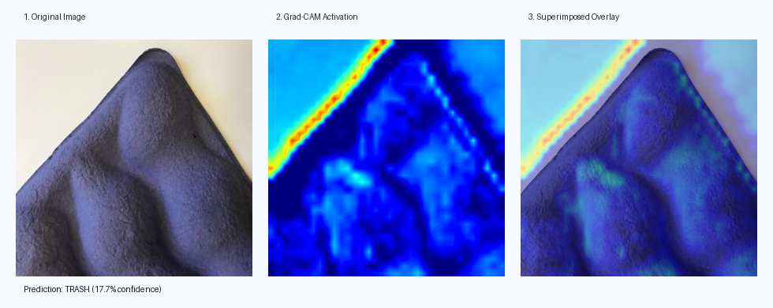

# 🗑️ Garbage Classification Model

[](https://github.com/vintendohuynh/GarbageClassificationModel/actions/workflows/ci.yml)
[](https://www.python.org/)
[](https://www.tensorflow.org/)
[](https://streamlit.io/)
[](tests/)
[](LICENSE)
[](https://huggingface.co/vincenthuynh/GarbageMLModel_CS549)

A Convolutional Neural Network (CNN) built with modern TensorFlow / Keras 3 to classify waste into 6 categories: **cardboard**, **glass**, **metal**, **paper**, **plastic**, and **trash**.

Trained on the [Kaggle Garbage Classification dataset](https://www.kaggle.com/datasets/asdasdasasdas/garbage-classification) (~2,500 images) with data augmentation, achieving ~92% validation accuracy.

### 🔗 [View on Hugging Face](https://huggingface.co/vincenthuynh/GarbageMLModel_CS549)

---

## 📁 Modular Python Architecture

```
├── app.py              # Interactive Streamlit Web Application & UI
├── assets/
│   ├── gradcam_demo.png # 3-panel Grad-CAM visual report
│   └── samples/        # Pre-packaged waste test images (6 categories)
├── src/
│   ├── __init__.py      # Package exports and version
│   ├── model.py        # Modern Keras CNN architecture, save/load (.keras & .h5)
│   ├── dataset.py      # Kaggle download, 80/20 train/val split, ImageDataGenerators
│   ├── train.py        # CLI trainer with configurable hyperparameters
│   ├── predict.py      # Inference pipeline & CLI for single images or directories
│   ├── explain.py      # Grad-CAM heatmap generation and visual overlay
│   └── utils.py        # Evaluation curves, confusion matrix, and reporting
├── tests/              # Comprehensive pytest test suite (24 tests)
├── requirements.txt    # Project dependencies
└── GarbageMLModel_CS549_cleaned.ipynb  # Original Colab notebook
```

---

## 🚀 Quickstart

### 1. Installation

```bash
pip install -r requirements.txt
```

### 2. Launch Interactive Web App (Streamlit)

Launch the web demo in your browser with one command:

```bash
streamlit run app.py
```

**Web App Features:**
- 📸 **Drag & Drop Upload**: Upload your own waste photos (JPG, PNG, WEBP).
- 📂 **Instant Sample Testing**: Select from pre-loaded samples across all 6 categories.
- 📊 **Confidence Distributions**: View sorted class probability bars and recycling disposal guidelines.
- 🔍 **Real-Time Grad-CAM**: Toggle heatmaps with adjustable layer selection, colormaps (`jet`, `viridis`, `turbo`), and overlay opacity.
- 📥 **Downloadable Diagnostic Reports**: Save the 3-panel visualization figure directly to your machine.

---

### 3. Training via CLI

Download dataset from Kaggle and train automatically:

```bash
python -m src.train --download --epochs 50 --batch-size 32 --model-path GarbageMLModel_CS549.keras
```

Or train from a local dataset directory:

```bash
python -m src.train --data-dir ./data --epochs 30 --plot-history history.png
```

CLI options:
- `--download`: Automatically fetch dataset via `kagglehub`.
- `--data-dir`: Root dataset folder with class subdirectories (or explicit `--train-dir` and `--val-dir`).
- `--epochs`: Training epochs (default: `50`).
- `--batch-size`: Batch size (default: `32`).
- `--lr`: Adam learning rate (default: `0.001`).
- `--dropout`: Optional dropout rate before output layer (e.g. `0.2`).
- `--early-stopping`: Patience for early stopping callback (e.g. `5`).
- `--plot-history`: Path to save training curves plot.

---

### 4. Inference via CLI

Classify a single image:

```bash
python -m src.predict --image example.jpg --model GarbageMLModel_CS549.keras --top-k 3
```

Output:
```text
Predictions for: example.jpg
--------------------------------------------------
1. glass            92.40% (index 1)
2. plastic           5.10% (index 4)
3. metal             1.80% (index 2)
--------------------------------------------------
```

Classify an entire directory or output as JSON:

```bash
python -m src.predict --dir ./test_images --json
```

---

### 5. Model Explainability via Grad-CAM (CLI)

Visualize which regions of an image the CNN focused on to produce its prediction:

```bash
python -m src.explain --image assets/sample_paper.jpg --output assets/gradcam_demo.png
```

This generates a 3-panel comparison figure (`Original Image` | `Grad-CAM Activation` | `Superimposed Overlay`):



---

### 6. Python API Usage

```python
from src.predict import GarbagePredictor

# Initialize predictor
predictor = GarbagePredictor(
    model_path="GarbageMLModel_CS549.keras",
    classes_path="classes.json",  # optional, defaults to 6 Kaggle classes
)

# Predict single image
predictions = predictor.predict("example.jpg", top_k=3)
for p in predictions:
    print(f"{p['class']}: {p['confidence'] * 100:.2f}%")

# Generate Grad-CAM attention heatmap
from src.explain import explain_image

heatmap, overlay, class_name, confidence = explain_image(
    image_path="assets/sample_paper.jpg",
    model_path="GarbageMLModel_CS549.keras",
)
overlay.save("attention_overlay.png")
```

---

## 🧪 Running Tests

Run the automated test suite with pytest:

```bash
pytest -v tests/
```

---

## 🧠 Model Architecture

- **Input Layer**: `(150, 150, 3)`
- **Block 1**: Conv2D(32, 3x3, ReLU) + MaxPooling2D(2x2)
- **Block 2**: Conv2D(64, 3x3, ReLU) + MaxPooling2D(2x2)
- **Block 3**: Conv2D(128, 3x3, ReLU) + MaxPooling2D(2x2)
- **Head**: Flatten -> Dense(128, ReLU) -> Dense(6, Softmax)
- **Format**: Native Keras 3 (`.keras`) with backwards-compatible `.h5` support

---

Created by Vincent Huynh | 📧 vintendohuynh@gmail.com
